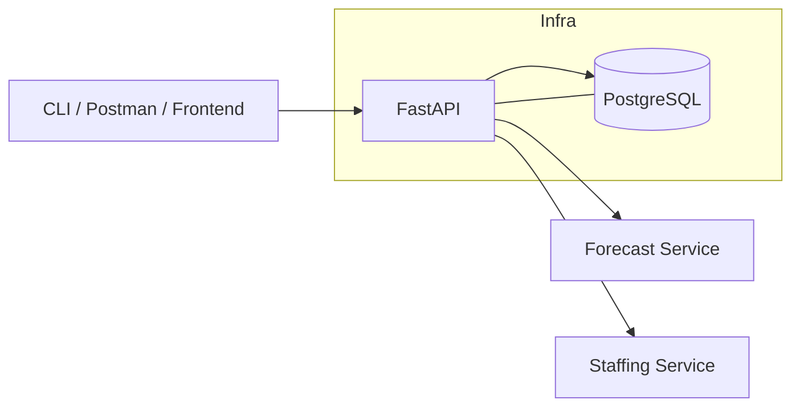
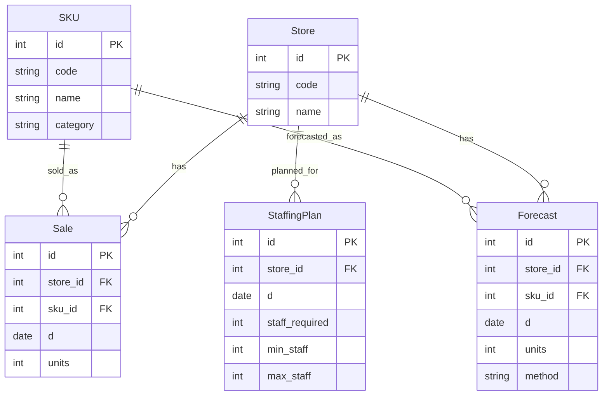

# Retail Demand & Staffing Optimizer (v1)
[](#)
[](#)
[](#)

Production-grade API that forecasts daily demand per store x SKU and produces staffing plans to hit service-level targets.

- Stack: FastAPI + SQLAlchemy 2.0 + Alembic + PostgreSQL + Docker Compose
- Features: CRUD for Stores/SKUs, ingest Sales, Moving-Average forecasting baseline, Staffing plan generator with constraints
- Quality: CI (pytest), Makefile, Postman collection, ASCII-safe docs
- Live Docs: `http://localhost:8000/docs` (after launch)

---

## Architecture (Mermaid)


---

## Domain Model


---

## Quickstart
```bash
# 0) Prepare env
cp backend/.env.example backend/.env

# 1) Run stack
docker compose -f infra/docker-compose.yml up -d --build

# 2) Init DB
docker compose -f infra/docker-compose.yml exec api alembic upgrade head

# 3) Seed demo data
docker compose -f infra/docker-compose.yml exec api python -m app.seed.seed_demo

# 4) Verify
curl http://localhost:8000/health
curl http://localhost:8000/api/v1/stores
curl "http://localhost:8000/api/v1/forecast/run?store_code=STORE-001&sku_code=SKU-COFFEE&window=7&horizon=7"
curl "http://localhost:8000/api/v1/staffing/plan?store_code=STORE-001&service_minutes_per_unit=0.5&shift_hours=8&min_staff=2&max_staff=12"
```

OpenAPI: `http://localhost:8000/docs`

---

## API Overview
- Data
  - `GET /api/v1/stores`, `POST /api/v1/stores`
  - `GET /api/v1/skus`, `POST /api/v1/skus`
  - `POST /api/v1/sales/ingest` (bulk JSON array of sales)
- Forecasting
  - `POST /api/v1/forecast/run?store_code=...&sku_code=...&window=7`
- Staffing
  - `GET /api/v1/staffing/plan?store_code=...&service_minutes_per_unit=0.5&shift_hours=8&min_staff=2&max_staff=12`

See `docs/postman_collection.json` for ready-to-run requests.

---

## Demo Preview
> Add these files into `docs/screenshots/` and they will appear here on GitHub.


---

## Roadmap
- v1 (this): moving-average baseline + staffing heuristic
- v2: exogenous features (promo/holiday), store hours by weekday, hourly staffing split
- v3: ILP optimizer (OR-Tools) and ML forecasting baselines

---

## License
MIT
